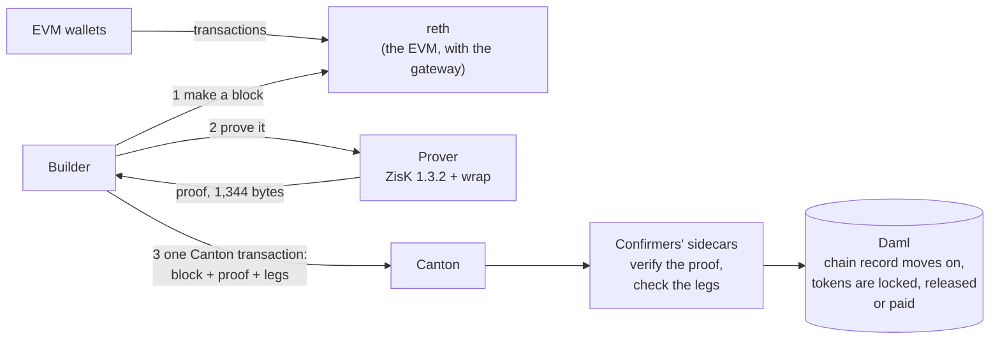

# ZK EVM on Canton: the design

Rome Protocol

## What we want

Ostia, a Canton zkEVM (chain id 770101): one EVM chain whose blocks are ordered by Canton and proven by a zkVM (ZisK), so that an EVM block and the Canton actions it needs settle together in one Canton transaction. A Canton token can move onto the EVM and back, an ERC-20 on Ostia can stand on Canton as a twin, and an EVM payment can be tied to the Canton payment it stands for. On DevNet the builder runs all the time (`builder.py run`) and cuts a block whenever transactions wait, and makes an empty block when a minute passes with none. By default it makes one block at a time; with `--max-in-flight` above 1 it cuts the next block while earlier ones prove, builds it on the newest, and submits only the oldest to Canton, in a thread of its own; `builder.py once` makes a single block, as the local network and the demo do. From 22:37 UTC on 26 October 2026 DevNet ran `--max-in-flight 3` (at most one more than the number of provers) on two GPU provers. Since 19:27 UTC on 28 October 2026 it runs `--max-in-flight 2` on one GPU prover. Since 04:26 UTC on 27 October it also runs a pre-check on each block (ziskemu, a predicted proof time budget of 120 s) before it is proven. There are no throughput targets yet.

## The idea

Every EVM block becomes one Canton transaction, and only once it is proven. That transaction carries the block, its proof and the Canton actions the block asked for. Canton's confirmers check the proof. Daml checks that the block follows the chain's current head. The block and its actions commit together, or neither does.

The EVM side writes down what a block needs from Canton. One small contract, the gateway, is part of the chain from its genesis. Transactions that have a Canton side go through it, and it keeps one running hash per block of the requests they made. Each request is a leg, and there are three kinds:

- **Deposit.** A Canton token is locked with the gateway, and its wrapped form is minted on the EVM to the address that claims it.
- **Withdrawal.** The wrapped form is burnt, and the gateway releases the Canton token to a Canton party.
- **Payment.** An ERC-20 payment made through the gateway executes a Canton allocation that the payer and the payee agreed to, for that payment and no other.

The proof fixes the chain's state at the end of the block, so it fixes what the gateway wrote. `Advance` receives the legs with the proof and settles all of them, or the Canton transaction fails and the block with it. The same check serves all three kinds. Adding the gateway needed no change to the proven program: it is ordinary EVM code, and the program key is the one the first proof used.

Two more legs, from Daml package 0.5.0, carry ERC-20s to Canton and back as twins (see "The registry, the vault and the twins"). Both are payments of a gateway, so the proof and the leg hash cover them as they cover any payment, and they differ in what Daml does with them. A lock is a payment into a vault, and Daml mints the twin to a Canton party. A release is a payment out of the vault against a redeem request, and Daml burns the twin.

## The parts

| Part | What it does |
|---|---|
| **reth** | A stock Ethereum execution client with our own genesis, which also holds the gateway. It makes a block only when the builder asks. Peer discovery is always off. |
| **Gateway** | The EVM contract that records each block's legs and makes the wrapped tokens. It has no owner, no admin key, no upgrade and no pause. See [gateway/README.md](../gateway/README.md). |
| **Vault** | The EVM contract that holds the ERC-20s behind Canton twins. It has no owner, no key, no upgrade and no storage, and the chain's record names it. See [gateway/README.md](../gateway/README.md#the-vault). |
| **Builder** | Picks the transactions, asks reth for the block, reads the block's legs and finds the Canton contracts they need (for a lock, its parts from the twin registry service; for a token whose registry asks for it, a choice context), sends the block to the prover, and submits the proven block with its legs to Canton. It cannot finalize anything or change Canton's order. |
| **Prover** | ZisK 1.3.2 running our copy of its EVM program, with our chain's rules built in. It outputs a small wrapped proof (1,344 bytes) that commits to the block's hash. |
| **Daml package** | The chain's one state contract (its current head), a record per block, and the contracts for deposits, withdrawals, payments and registered tokens. From 0.5.0 the chain record also holds a registry of EVM contracts and the pinned twins. See [daml/README.md](../daml/README.md). |
| **Twin and its registry service** | `ostia-twin` is the CIP-0056 token that stands on Canton for one ERC-20. The registry service serves the token standard's registry API for the twins and the parts of lock ids; it holds no key and writes nothing to Canton. See [apps/twin/README.md](../apps/twin/README.md) and [apps/twin/registry/README.md](../apps/twin/registry/README.md). |
| **Sidecar** | A small Rust program beside each confirming participant. It does two things: `verify` checks a proof, and `legs` checks that the legs attached to a block hash to the value the proven block recorded in the gateway (an account proof and a storage proof, at the block's state root). |
| **Canton network** | Where Ostia settles, with a party for the gateway. Ostia DevNet settles on Canton Network DevNet, on one participant that hosts every Ostia party and has one sidecar, so there is one confirmer. A second DevNet participant is up with its own sidecar but hosts no party. Both sidecars pinned both program keys (two `--key` entries, one for key A with release 1.3.1 and one for key B with release 1.3.2) until 12:06 UTC on 28 October 2026, and pin key B only since. The local network of our own, which the demo ran on, has two confirming participants. |
| **Explorer** | Shows each EVM block next to its Canton record, read as the reader party, from a database of its own that an indexer fills. It also shows the legs of registered gateways and the twins' lock and release legs, and compares each twin's supply with the vault's balance. It serves a REST API, an Etherscan-compatible API, a live stream and an optional public RPC that shows only final blocks. Its Verify button runs the sidecar's block check in the browser through WebAssembly. Its faucet sends the test coin, tROME, through reth. See [The explorer](#the-explorer). |

## One block

1. Wallets send EVM transactions to reth as usual. A transaction that has a Canton side calls the gateway, which writes the leg and folds it into the block's running hash.
2. The builder asks reth for block n on top of the chain's current head, and reads the legs from the gateway's events.
3. For each leg the builder looks for its Canton side: a deposit needs the depositor's request and allocation, a withdrawal needs the receiver's standing acceptance, a payment needs the terms that carry its id, a lock needs its parts from the twin registry service and a receiver that is a Canton party, and a release needs the holder's redeem request. If a leg has none, the builder leaves out the transaction that made it, moves reth back to Canton's head and builds again. Nothing has been proven by then.
4. The prover proves block n.
5. The builder submits one Canton transaction: block n, its proof, the legs and the gateway's proofs of its state at the end of the block, with the same proofs and legs of every registered gateway, and the choice context and disclosed contracts of each leg whose token's registry asks for them.
6. Each confirmer's sidecar verifies the proof. Daml checks that block n's parent is the current head, that the proof came from our program and ZisK release, that the block is within the gas cap, that a block with a leg is not committed while the legs are paused, and that its withdrawals stay within the chain's withdrawal quota, if one is set (see [daml/README.md](../daml/README.md)).
7. Daml writes one line for each leg from the Canton contracts it names, and the sidecar hashes those lines as the gateway does and compares the result with the value the proven block recorded. A block with no legs is checked in the same way, with no lines, which is how it is shown that it needed none.
8. Daml settles the legs in order: it locks the deposited token, pays the withdrawn token to its receiver, executes the payment's allocation, mints a twin for a lock, or burns one for a release.
9. Canton commits everything at once: the chain record moves to block n, the block is recorded, and the legs settle. If any check fails, nothing changes; reth returns to Canton's head and the next builder run builds and proves again.

## The flows

**A deposit.** The depositor, U, allocates a Canton token to the gateway, with the operator as executor, and signs a deposit request: a label, the id derived from the depositor's party and that label, the EVM address that may claim, and the allocation. The address sends `claim(id, token, amount)` to the gateway, which mints the wrapped token to the sender and records a deposit leg. The builder matches the leg to the request by its id. `Advance` executes the allocation, so the token is now held by the gateway. The block record and the gateway's new holding come from one Canton update.

**A withdrawal.** A holder sends `withdraw(token, amount, party)`. The gateway burns the wrapped tokens and records a withdrawal leg that names the Canton party. That party must already have signed a standing acceptance of withdrawals; if it has not, the builder leaves the transaction out. `Advance` has the gateway pay the Canton token from its custody to the party, through the token registry's own transfer factory. Again the block record and the new holding come from one update.

**A payment tied to a Canton payment.** U allocates a Canton token to V. U and V sign terms that name a payment id, the EVM token, the payee and the amount; the id is derived from U, V and a label, so only terms both signed can carry it. V approves the gateway and sends `pay(id, token, to, amount)`, which moves the ERC-20 from V to the payee and records a payment leg. `Advance` executes the allocation, and V gets the Canton token. A plain transfer of the same token, even to the same person in the same block, is not a payment: it moves the token on the EVM, but it records no leg and settles nothing on Canton. This replaces an earlier rule that settled a leg when the holder's balance rose by the expected amount in the block. That rule could not tell the payment from any other transfer of the same size.

**A twin of an ERC-20: lock, send, redeem.** An EVM holder who wants an ERC-20 on Canton chooses the Canton party that is to receive it and a `ref`, and asks the twin registry service for the lock id (the SHA-256 of `lock,<receiver>,<ref>`) and the vault. The holder checks the id itself, approves the gateway and pays the token into the vault with `pay`. The service now holds the receiver and the `ref` for that id. The builder checks that the receiver is a Canton party, reads the parts from the service and attaches a lock leg. `Advance` mints the same amount of the twin to the receiver in the Canton update that commits the block. On Canton the twin moves like any CIP-0056 token, through the transfer factory that the registry service serves, and the transfer completes at once. To redeem, the holder of the twin signs a redeem request (the holdings, the amount, the EVM recipient and a `ref`), and `Vault.release` with the same `ref` pays the recipient from the vault. The builder attaches a release leg, and `Advance` burns the amount from the request's holdings and archives the request. After each step the twin's supply equals the ERC-20 that the vault holds.

**A Canton token whose registry needs a choice context.** A deposit and a withdrawal of Canton Coin run as the flows above, and each leg also carries the registry's choice context: the open mining round and the amulet rules. The builder asks the token's registry for it, through the validator's scan proxy for Canton Coin, and passes it unchanged, with the contracts it names disclosed. The context is not in the leg line that the proof fixes, so a wrong one can only make the registry refuse the leg, and the block with it.

**Why neither side can be final without the other.** A block cannot commit without every leg it recorded, and a leg cannot settle outside `Advance`. A payment made on the EVM does not become final until the Canton payment it names has been made, and the other way round.

## The registry, the vault and the twins

These came with Daml package 0.5.0. [daml/README.md](../daml/README.md) has the fields and every refusal.

**The registry of EVM contracts.** Besides the first gateway, the chain record lists the EVM contracts that it trusts: at most 16 entries, each an address, the keccak-256 of the contract's runtime code and a kind, gateway or vault. An entry is added the way a program is changed. The operator and the gateway propose it, and the confirmer accepts it once the chain's change delay has passed. For a registered gateway, Daml checks the code hash against the account proof that the block carries, and the sidecar checks that the proof leads from the proven state root. A block carries the legs and the proofs of every registered gateway, and a block that leaves one out is refused. What the contract does is guarded by the confirmer, who accepts an entry only after reading the deployed code. This version has no removal.

**The vault.** `gateway/Vault.sol` holds the ERC-20s behind the twins. A lock is a plain `pay` through the gateway with the vault as the payee, and the vault has no code for it. A release is `release(ref, token, to, amount)`, which pays through the gateway against the id `vault-release,<vault>,<ref>`. No id of another kind has that form, so the vault cannot be made to pay another payment's id. Canton settles a release only against a matching redeem request. The vault has no owner, no key, no upgrade, no storage, no `delegatecall` and no `selfdestruct`, and `tests/static.sh` checks the opcodes of its runtime code.

**The twin.** `ostia-twin` ([apps/twin](../apps/twin/README.md)) is a CIP-0056 token for one ERC-20, with the instrument id `erc20:<address>`, administered by the gateway party. It is one to one with the ERC-20 that the vault holds. Mint happens only inside `Advance`, against a lock line that the proof fixed. Burn happens only against a redeem request that the holder signed. A Daml amount has 10 decimals, so an ERC-20 amount converts exactly, and an amount finer than that is refused and never rounded. The chain record pins each twin: the token's address, its decimals and the rules contract that converts it. A lock or release leg is accepted only for the pinned rules. A twin is pinned the way a registry entry is added, and a pin has no removal in this version.

**Lock ids and the registry service.** The gateway records a payment's id and nothing of its parts, and a hash cannot be read back. So the payer announces the receiver and the `ref` to the twin registry service before paying, and the builder reads them to attach the lock leg. The builder makes the id again and refuses parts that do not give it. The same service answers the token standard's registry API for the twins (metadata, factories and their choice contexts), so a wallet can send twins. The ledger checks what it serves: the twin's factories check the admin, the instrument and the amounts, and `Advance` checks every lock leg against the block.

**Deposit ids.** From 0.5.0 a deposit's id is the SHA-256 of `deposit,<depositor>,<label>`, and the depositor chooses the label. The depositor signs the request, so only the depositor can make an id derived from their own party. Before this a deposit id was any 64-hex value, which let a depositor claim the id of a pending release or lock first. The tag `deposit` is the tag of no other id. A request made under 0.4.0 or earlier has no label, and it is refused when its leg settles.

**A leg's choice context.** A deposit, withdrawal, payment or trade leg has one more field, an optional choice context, which the registry's token-standard choice reads from `extraArgs.context`. Canton Coin needs it, and the reference test token does not. Daml does not read the entries, and the leg line that the sidecar checks does not change. The disclosed contracts that the context names go with `Advance`, not with the leg.

## ZisK releases

A chain's proofs are made with one ZisK release, and a chain can move to a newer release as it can move to a new program (the same key ranges). ZisK 1.3.1 has a critical soundness advisory (GHSA-3j5v-j2rm-9c5f) that 1.3.2 fixes, so a new chain runs on 1.3.2 (see [SECURITY.md](../SECURITY.md)). The verifying key of ZisK's final PLONK circuit is the same in 1.3.1 and 1.3.2; the program key and the root of the final circuit are not, and they are what the confirmers pin. The sidecar and the explorer name the release of a chain, because the release picks the key a proof is checked under: the sidecar by `--zisk-release 1.3.1|1.3.2`, the explorer by `zisk=` and `zisk@<block>=` lines for each key range of its pins file. A chain that names no release is on 1.3.1, so a chain that is already running does not change when the code moves on. The blocks a chain proved under 1.3.1 stay on it, and they are only as trustworthy as the prover that made them. Ostia DevNet made this move on 27 October 2026, its first use of the key ranges: key A (programVK `0xdb79251d...`, ZisK 1.3.1) covers blocks 0 to 15572, and key B (programVK `0x424aeb2b...bd69`, rootC `0x6b2490fb...b265`, ZisK 1.3.2-alpha) covers block 15573 onward, from 12:02 UTC. The explorer shows the ranges: A from block 0 and B from block 15573.

## Why it holds

- **No proof, no block.** `Advance` verifies the proof before Canton commits the block. The builder returns reth to Canton's head after a refused submission.
- **Canton orders.** Every block consumes the chain's one state contract, so Canton alone decides which block comes next.
- **The proof fixes the rules.** Our program refuses any chain settings except its own, and every confirmer pins that program's key. A block proven under other rules is refused. The genesis state root in the chain record fixes the gateway's code, so the gateway cannot be changed.
- **The legs are the block's legs.** The attached legs must hash to the value the proven block recorded in the gateway. A leg that is missing, an extra one, a different order, or any changed field (another recipient, amount, id or token) gives another hash, and `Advance` is refused.
- **Canton legs settle only with a proven block.** Settling a leg requires the operator and the confirmer, and for a deposit or a withdrawal the gateway as well. The design provides their joint authority only inside a block's transaction. The builder cannot settle a leg. The operator and confirmer together are the root of trust because they both sign the chain record.
- **The chain can be re-checked.** A party that can read the block records, such as the reader party, can re-verify every proof. The explorer exposes that reader's view. The records last as long as Canton's databases do: the default local network keeps them in memory and loses them on restart, and a network started with `CZE_PERSIST=1` keeps them in PostgreSQL (see [network/README.md](../network/README.md)).

**Custody.** The gateway party holds the Canton tokens that are locked for their wrapped forms. It is hosted on the operator's participant, so whoever runs that participant can move the locked tokens. Under the Daml rules, they leave only inside `Advance`, for a withdrawal that the proven block recorded, and the chain's withdrawal quota, if one is set, bounds what `Advance` settles out per window (not what the hosting participant can move); but a Canton party can always act through its own participant. This is acceptable on the local network and on DevNet, where Rome runs every party, and not for anything of value. Registering a token is also a trust decision, because the gateway runs that token's registry's Daml code with its own authority.

## The explorer

The explorer is three processes and one database. The server answers the pages and the APIs. The indexer is the only writer of the chain's tables. A verifier, which is off unless it is started, checks contract sources. They share a PostgreSQL that the explorer owns, apart from the one Canton uses (see [network/README.md](../network/README.md#the-explorers-database)). The explorer never submits to Canton. The only thing it sends to reth is the faucet's transfer and the transactions a wallet gives to its public RPC. [explorer/README.md](../explorer/README.md) has the routes, settings and commands.

**What it reads.** From reth, three fixed lists of methods. The server's own list is `eth_` reads, the faucet's fee reads and send, and `trace_transaction` for one transaction's call tree. The public RPC's list has 20 methods, among them `eth_getLogs`, `eth_estimateGas`, `eth_feeHistory`, `net_version` and `web3_clientVersion`. The indexer's own list is `eth_getBlockByNumber`, `eth_getBlockReceipts`, `trace_replayBlockTransactions` and the state reads (`eth_getStorageAt`, `eth_getCode`, `eth_call`, `eth_getBalance`). reth serves `eth`, `net`, `web3` and `trace` on its HTTP port. A reader asked for any other method refuses before it calls. From Canton, three calls on the JSON Ledger API of the participant that holds the reader party: the ledger end, the participant's id, and the updates after the last offset it has seen. The updates request is filtered to the reader party and the block record template (`explorer/server/ledger.ts`). One more call is optional: when the gateway party and a token for it are configured, the indexer reads the gateway's registered tokens and holdings as the gateway party (`POST /v2/state/active-contracts`, with a client and a token of its own, at the offset of the newest indexed block's record) to publish the custody next to the wrapped supply; it assumes the gateway party is hosted on the participant at `LEDGER_URL`, which holds on DevNet and not on the local network.

**What the reader party can see.** The reader is an observer of the block record and of nothing else in the Daml package (`BlockRecord` in `daml/src/Zk/Chain.daml`). It sees each record's number, hash, parent hash, header, transactions and proof, the update id and record time, and the two signers, the operator and the confirmer. It does not see the gateway's holdings, the deposit requests, the withdrawal acceptances or the payment terms. The explorer reads the builder's and the reader's party ids from the record and keeps neither. The local network has no login on its Ledger API, so the limit comes from what the explorer asks for, and a test holds it to that list. A participant with a login gives the explorer a user token with read-only rights on the reader party.

**Final only.** reth makes a block its head while the block is still being proven, and goes back if Canton refuses it. So the indexer writes only blocks that have a record on Canton, and every row of the chain's tables (blocks, transactions, logs, balances, legs and what stage 2 derives from them) is final. The rows that describe attempts are the exception: the builder's block attempts, the transaction lifecycle, the tracked transactions and the faucet's requests also hold blocks and transactions that are not final yet, and `GET /api/in-flight` serves the block attempts and the transactions that are not final yet with `final: false`. A tracked transaction's state is on its own page (`/api/txs/{hash}`) and the faucet's requests are on `/api/faucet`. The REST list routes and the Etherscan-compatible API serve the chain's rows. A block or transaction that is not in the database is shown from reth, with no Canton side, and with its status: `proving` (above reth's finalized block, so not final yet), `unindexed` (at or below reth's finalized block, so final on Canton, but not yet indexed) or, for a transaction, `waiting` (in the pool). The Address page reads `/api/addresses/{address}`, whose balance is reth's at the newest indexed block, which is final; `balanceBlock` names that block. The public RPC ends at reth's finalized block, which is Canton's head: a receipt from it means the block is proven and final on Canton.

**The indexer.** Stage 1 takes each record the reader can read and the block and receipts from reth, runs four checks, and writes the block, proof, transactions, logs, balances, addresses and gateway legs in one database transaction with its cursor. The checks compare reth's block hash with the record's hash and the Keccak of the record's header, the order of the records and block 1 against reth's genesis, the record's transactions against reth's, and the program key and the ZisK release in the proof against the explorer's pins. A check that fails stops the indexer before it writes. The block hash that the proof commits to is recorded and shown on the block page, and a mismatch does not stop the indexer: the first check stops a wrong block. It never restarts by itself, and the explorer answers 503 until a person has read the log and started it again. Stage 2 works from the block's traces behind its own cursor and writes internal calls, contracts, tokens and token transfers. A route that returns something stage 2 writes says it is not derived yet until the cursor has passed the block. The indexer also loads the builder's journal, which gives each transaction its lifecycle from accepted to final, and it runs the stats rollups and the health checks.

**The APIs.** The REST API (`/api/...`) lists blocks, transactions, addresses, contracts, tokens, legs and Canton updates, and every route is in `/api/openapi.json`. Lists page by key, in each route's own order (newest first for the chain-wide lists, taking `before`; ascending for the rows of a block or a transaction and an address's token holdings, taking `after`), 25 rows by default and 100 at most. `/api/txs`, `/api/tokens` and `/api/contracts` can also be read from the other end with `order=asc` and `after`, which the pages use to open a list on its last page. The Etherscan-compatible API (`/api` and `/v2/api`) answers the `module` and `action` calls that Foundry, Hardhat and ethers send, in Etherscan's shape. It takes no API key. `GET /api/labels` gives the name, symbol, kind (token, contract or account), standard and decimals of up to 100 addresses at once, and the pages use it to show a token or a contract by name. Every transaction in a list carries its token moves, and the unfiltered `/api/txs` and `/api/stats/summary` (`txs.allTime`) carry the exact all-time transaction total, read from the rollups and never counted over the transactions. An address's transactions take `direction=sent|received|all`, and its transactions and its token transfers can be downloaded as CSV with `format=csv`, for example `/api/addresses/{address}/txs?format=csv` (JSON is the default). The address's transfers also filter by standard (`nft` for ERC-721 and ERC-1155 together). `/api/addresses/{address}` adds how many contracts it made (the list is under `/contracts`), the transaction that first funded it (when that is in the block the address first appeared in) and when it was first and last seen. `/api/token-transfers` is the transfer feed of every token, and each transfer carries the transaction's method id and time, the token's standard and whether the transaction made a contract. The token list filters by standard (ERC-20, ERC-721 or ERC-1155) and carries counts for each, and a token names its creator. A contract carries the count of its events and, once verified, how the source came in (`method`) and the compiler's version, and the contract list carries its totals and counts for all, verified and not verified. `GET /api/faucet` reports how many payouts were sent today, how many of those are final and how many are in a block being proven now, and the final block the balance was read at (`balanceBlock`). If the finalized block or the balance at it cannot be read, the balance is the latest one and `balanceBlock` is null. `GET /api/stream` is a server-sent-events stream of new blocks, transactions and stats. `POST /rpc` is the public RPC, on when `PUBLIC_RPC=1`. Every object the API returns carries only the fields listed in `FIELDS` in `explorer/server/rest/fields.ts`, and no party id except the two signers.

**Faucet refusals.** A request the faucet turns away for its address, its network address, the hourly cap or a failed human check adds 1 to a count for that UTC minute and reason in `faucet_refusals`, and nothing else is stored with it: no address, no client hash, no ticket. The counts are kept 90 days and appear as `faucet.turnedAway` in `/api/stats/summary`. They are written in batches about every 5 s, so a crash can lose the last few seconds.

**Contract verification.** `POST /api/verify`, or `verifysourcecode` on the Etherscan-compatible API, queues a Solidity source of at most 500 KiB. The verifier role takes one job at a time. It downloads the compiler named in the request and checks its SHA-256 against the compiler list, then runs it in a throwaway container with no network, a read-only filesystem, one CPU, 2 GiB of memory, 128 processes, no capabilities and a 60 s limit (`explorer/server/verifier/sandbox.ts`). The compiled code is matched against the code at the address by lib-sourcify (`@ethereum-sourcify/lib-sourcify`), which gives a full match or a partial match (only the metadata differs). The explorer then marks every other contract with the same runtime code and no verified source of its own as a similar match, except the gateway (`markSimilar` in `explorer/server/verifier/verify.ts`). A verified source belongs to the code at an address, not to the address.

**Rate limits and health.** Most limits are per client and have no keys: 20 requests a second with bursts of 60 for the pages' REST routes and `/healthz`, 10 a second and 600 a minute for the Etherscan-compatible API, 30 verifications an hour, and `RPC_RATE_PER_MINUTE` calls a minute for `/rpc` (`explorer/server/limits.ts`). One limit covers all clients together: at most `RPC_HEAVY_CONCURRENCY` heavy `/rpc` calls (`eth_call`, `eth_estimateGas`, `eth_getLogs`) run at once and `RPC_HEAVY_QUEUE` wait, and one past that is refused at once with `Retry-After` (`explorer/server/rpc-heavy.ts`); light calls never wait behind them. Health is a table of checks, each written by the indexer, an API instance or the verifier with its status (`ok`, `degraded` or `down`), the value seen and its threshold. `GET /api/health` lists them. A row that its writer has not refreshed within three of its intervals counts as failed, so a stopped indexer turns `/healthz` red instead of leaving its last `ok` behind. A `down` check makes `/healthz` answer 503. A `degraded` check is named and the answer stays 200.

**Stats.** The indexer rolls its facts up every 10 seconds into minute, hour and day tables (`stats_minute`, `stats_hour`, `stats_day`). A run changes nothing if repeated, and `stats-rebuild` fills them again from the facts. Times come from histograms with buckets 5% wide, so a percentile is at most 5% above the truth. A time or rate with nothing behind it is null, not a guess. `GET /api/stats/summary` and `GET /api/stats/series` serve them.

**Budgets.** Tests enforce seven limits on indexing time, API latency, stream delivery, page loading and database size. The figures measured against them are in [METRICS.md](METRICS.md), in "The indexer on a real chain (W1)", "The API at scale (L2)" and "The nightly load test".

| Budget | Limit | Measured by |
|---|---|---|
| B1 Stage 1 of the worst-case block | At most 2,750 ms (`B1_MS`). The target for a block of up to 1,428 transactions is 1.0 s: L1 holds it on the runner, and L3 is still to be measured on the reference machine | L1 (blocks of 0 to 5,000 transactions), W1 (the costliest block the 30 Mgas cap allows, on a real chain; B1 and W1 were set at the 30 Mgas cap, DevNet's cap has been 60 Mgas since 27 October 2026, and a full block there holds about 2,857 plain transfers, so they have not been re-stated for it), and L3 (the index lag under a flood of blocks: from the block's record being readable on the reader's participant until its row is visible in PostgreSQL) |
| B2 Both stages of that block | At most 12,750 ms (`B2_MS`). The reference-machine measurement of W1 was 3,998 ms (provisional, see below). On GitHub's shared runner W1 is checked against 16,000 ms (`B2_RUNNER_MS`, 1.25 times `B2_MS`, rounded to 250 ms) | L1, W1 |
| B3 The API, mixed load at 200 requests a second | p95 at most 100 ms for one block, transaction, address or search; 200 ms for a list page; 300 ms for an address's page of transactions; 500 ms for `getLogs` | L2 |
| B4 Live stream | A new final block reaches 2,000 clients in p95 at most 500 ms | L2, L3 |
| B5 Page load, cold, 10 Mbit/s and 100 ms round trips | Largest contentful paint at most 2.0 s for Home, Block and Transaction; at most 200 KB of gzipped script | L4 |
| B6 Database size | At most 2.5 GB per million transactions, indexes included | L2, L3 |
| B7 `/api/health` | p97.5 at most 50 ms, and no answer other than 200 | L2 |

L1 to L5 and W1 are described in [explorer/README.md](../explorer/README.md#the-load-tests-and-the-nightly). L1 and a scaled L2 (3,000,000 transactions, 120 s) run on every explorer pull request (`explorer.yml`). W1 also runs in the demo's rehearsal (`demo.yml`) on a pull request that changes the explorer. L3, L4, L5, W1 and the full-size L2 run in the nightly. A short version of all of them runs on a pull request that changes the nightly's files. B1 and B2 were set from W1's slowest run on the runner with 25% headroom, on 2026-10-22. Since 2026-10-23 they are the budgets of the reference machine, where W1 measured B1 806 ms and B2 3,998 ms (p50 of 5 runs). That measurement is provisional: its commit and command were not recorded. The W1 test on the runner checks elapsed time against the 16,000 ms line and B1 against 2,750 ms. The reference measurement is to be repeated, with the commit, command, machine and raw results recorded, when the indexer's write path changes. The figures, with their dates and what was and was not recorded, are in [METRICS.md](METRICS.md), "B1 and B2 on the reference machine and on the runner".

## What the demo showed

On our own local Canton network, in a setup block and five runs ([demo/README.md](../demo/README.md) has them in full):

- **A deposit** of 10 TKB: U ends with 10 wTKB, and the supply of wTKB and the gateway's custody are both 10.
- **A payment** of 10 TKA from V to U against U's allocation of 10 TKB, with a plain transfer of 1 TKA in the same block that moved on the EVM and made no leg.
- **A withdrawal** of 4 wTKB: U gets 4 TKB, and the supply and the custody fall to 6.
- **A payment whose allocation is taken back after the proof was made:** Canton refuses the block and nothing moves. The same proven block sent again without its leg is refused too ("the legs are not the ones the block recorded"). The next builder run leaves the payment out and commits.
- **A tampered proof:** refused by the sidecar, and nothing moves.

These ran on a local network started for the run. The same three legs have since run on DevNet; see "Ostia on DevNet" below.

## Ostia on DevNet

Ostia opened on Canton Network DevNet on 22 October 2026 (Canton 3.6.3, chain id 770101). Everything below is as of 25 October 2026, except where a bullet carries a later date. As of 27 October 2026 DevNet's validator runs Splice 0.9.4 with Canton 3.6.4, and the repository's pin of 3.6.3 is for the local network and CI. The setup is in [network/README.md](../network/README.md#running-on-an-existing-participant-the-canton-network); how to use it is in [TRY-OSTIA.md](TRY-OSTIA.md).

- **One confirmer.** One participant hosts every Ostia party, so its one sidecar is the only confirmer (threshold 1). The local network has two. As of 27 October 2026 a second DevNet participant is up with its own sidecar but hosts no party; a 2-of-2 confirmation is not switched on, and moving to it is open work. The participant's operator can see every Ostia contract and act for every Ostia party, the gateway party included.
- **Rome runs every Ostia service.** The participant that hosts every Ostia party, and so the one confirmer, is Rome's DevNet validator. Rome also runs the one builder, the two provers (since 26 October 2026), the public RPC, the explorer and the faucet. There is no forced inclusion: the RPC and the builder can refuse or omit a transaction. The explorer's indexer checks every record against reth, but the RPC and the explorer are views that Rome runs, not trustless ones.
- **What the proof fixes.** Each block was executed under this chain's compiled rules. The confirmer's sidecar checks the proof, the header and the transaction root before Canton commits, and anyone can check a block's proof again in the explorer.
- **The legs are live, run by Rome.** On 25 October 2026 a deposit, a payment and a withdrawal ran on DevNet with TKB, Splice's reference test token, and its wrapped form wTKB (`0x294d3049874526910a69f6b61da14d10a8b1b3af`): first between 08:08 and 08:10 UTC (blocks 780, 783 and 784), then again from 11:31 to 11:34 UTC under package 0.2.0 (blocks 1465, 1471 and 1473). Each leg was in a block of its own, with the block record and the holding change in one Canton update, and after the second run the wTKB supply was 12. Rome's run checked that the gateway then held 12 TKB on Canton, equal to that supply; the explorer shows this on wTKB's token page (custody 12 TKB, supply 12 wTKB), as it has since 12:27 UTC on 25 October 2026. The parties U and V are test parties that Rome runs on its own participant. Outside users can watch the legs on the explorer but cannot make their own yet; self-serve Canton accounts are not built. Rome has cycled a deposit, a payment and a withdrawal every 10 minutes since 25 October.
- **Blocks are packed by gas used, and an idle chain still makes blocks.** The builder fills a block by the gas its transactions use, not the gas they declare, and normally offers reth no more than a cap on their raw bytes (`--max-block-tx-bytes`, 196,608 on DevNet on 25 October and 393,216 since 27 October 2026, together with the gas cap of 60,000,000; the first transaction is always offered, so an oversized one does not wait for ever) because the participant's Daml work grows with the size of the `Advance` argument. With no transaction waiting, the builder makes an empty block after 60 seconds (`--heartbeat-seconds 60`; the default is off), so a quiet chain no longer goes hours without a block.
- **Daml packages.** Package 0.2.0, an upgrade of 0.1.0 with the same templates, went live at block 1453 (25 October 2026, 11:29 UTC) and the chain kept its contracts through the upgrade. It removed the character-by-character hex check from `Advance`; the sidecar still performs that check. In the measured runs, the participant's work per KB of the `Advance` argument fell from about 23 ms to about 3 to 5 ms per pass. 0.3.0 followed at 22:01 UTC on 26 October and added the proposals for the gas cap, the program and the change delay, and the pause and quota of the legs. 0.4.0 (`4f57b2ae083bf65b23d90f90aca64bab42ba4269a16c77a0236aa0d1a295d75f`) has been pinned since 15:44 UTC on 27 October and adds `VenueTrade` and `FundedClaim`, a Canton venue's trade settled by a proven EVM payment.
- **A swap run by a Canton-native app, 27 October 2026.** At 15:55 UTC an atomic swap of a CIP-0056 token (TKB) for an ERC-20 (TKA, `0xf4b69022b3e6501101600743f17fbe0659dd1af8`) ran on DevNet, driven by the OTC app in `apps/otc` (package `otc-venue` 0.1.0, which depends only on the token standard). The `VenueTrade` is signed by the venue and the seller. The buyer's payment in block 16816 committed in one Canton update (`1220ad687926fde1ca580721ea5ab457935b054b82be35435ff52056d3d5adb98a74`) with the seller's allocation executed, the claim was in block 16823 (update `1220f08d8e2cfeca915416a678735f0d236f1cef0a6ab695d79594ac459642f7ff14`), and a short payment was left out of block 16834.
- **Self-recovery and checks, 27 October 2026.** Both GPU machines are spot machines and restart on their own after a preemption (a scheduled job starts each GPU machine again); the prover services start at boot. The explorer's health checks include the id sequences of its database (degraded above 50% used, down above 90%), after an id exhaustion on 27 October (fixed in #120).
- **No privacy yet.** Ostia does not provide private transfers. The test of TACEO's Merces private-transfer contracts ([results](../load/mixed/RESULTS-2026-10-24.md)) submitted transfer requests with client-made proofs that the on-chain verifier accepted. No MPC network processes those requests, so Merces private balances do not settle.

## Numbers we have

The machine, the versions and every measurement, with dates and sources, are in [METRICS.md](METRICS.md).

- Proof: 6.7 s (1 transfer) to 21.2 s (5,000 transfers) on one NVIDIA RTX PRO 6000, with a prover that stays running. Measured in the prover benchmark on the upstream reth guest, not on this repository's guest; see [METRICS.md](METRICS.md).
- Proof size: 1,344 bytes. Measured.
- On this chain, in the demo (2026-10-05, one machine, commit `6b445073163832e9023850f53678617d90dfc808`): a block with no transactions was proved in 6.31 s, and the blocks of the runs in 6.71 to 6.75 s. The time from the finished proof to Canton's commit on both confirmers and reth marking the block final was 0.49 s for an empty block, 0.66 s for the deposit, 0.42 s for the payment and 0.58 s for the withdrawal. That interval also includes fetching the gateway's account and storage proofs from reth (one `eth_getProof` call), so it is more than Canton's commit alone. The builder matches the legs to Canton contracts before it proves the block, so that work is not in it. Measured; see [demo/results/](../demo/results/).
- On DevNet, in the one-hour mixed load of 2026-10-24 (blocks 224 to 448, 13,496 transactions, all final): for blocks of 11 to 100 transactions the proof took 9.03 s at the median, and a block was final 11.01 s after it was made at the median. A block is "made" when the builder cuts it; "final" is when Canton has committed it. The run was capped by one client's RPC budget, not by the chain, so it did not find the chain's limit. See [load/mixed/RESULTS-2026-10-24.md](../load/mixed/RESULTS-2026-10-24.md).
- On DevNet on 25 October 2026, after the upgrade to package 0.2.0: blocks of 1,428 plain transfers (the 30,000,000 gas cap) committed on Canton with a p95 of 8.6 s from submission to answer, and the chain carried 64 such transfers a second in steady state. The mixed load ran at 10.9 tx/s before 0.2.0 and has not been measured since. See [METRICS.md](METRICS.md#devnet-throughput-2026-10-25) and the prover's largest block, a benchmark-machine result, under "The largest block the prover was given".
- On DevNet on 27 October 2026, at the 60,000,000 gas cap with depth 3 on two GPU provers and the pre-check on: a block holds about 2,857 plain transfers, a burst of 9,000 plain transfers took 79 s from the send to the last block final, with blocks cut at a pace of about 200 tx/s (a block about every 14 s, a proof of 18 to 22 s for a full block), and the fee-stable sustained rate (the highest steady rate at which the base fee did not climb) was about 93 tx/s. At the 30,000,000 cap a two-GPU burst ran at 158 tx/s steady and the fee-stable rate was about 75 tx/s. The 64 tx/s above is the 25 October figure at depth 1 on one GPU. See [METRICS.md](METRICS.md#devnet-throughput-2026-10-26-and-27).
- Not yet measured on their own: building the witness on a warm machine and the sidecar's proof check run natively. The WebAssembly build took 8 to 32 ms in Node on CI runners for verifying a proof and rejecting a mismatched header; see [explorer/verify/README.md](../explorer/verify/README.md).

The recorded GPU demo ran from commit `6b445073163832e9023850f53678617d90dfc808` of this repository (6b44507). The Daml tests check the refusals of each leg kind; the GPU runs and the CI rehearsal check the cases listed in [demo/README.md](../demo/README.md#results).

## Rules

- The supplied reth launcher disables peer discovery.

## Not now

Throughput and block-time targets, more than one builder, forced inclusion, Canton TestNet and MainNet, privacy and hardening. Open now, as of 27 October 2026: the Osaka checks at 12:00 UTC on 28 October, when the chain's `osakaTime` (1793188800) is reached; a proposal step for the seller's signature on a venue trade (Daml 0.5.0) before mainnet; 2-of-2 confirmers; and the fee design, which is a mainnet item. Hardening includes custody that needs more than the operator's participant (for example, the gateway party hosted on more than one participant, with a threshold), and a builder that remembers, across restarts and for `once`, which transaction a token registry refused (`run` leaves a suspected transaction out for a cool-down after two refused blocks, but forgets it on a restart; `once` still needs `--exclude`). The recipient of a deposit sends its own `claim` and so needs a little tROME for gas; the gateway's `claim` mints to its caller, so the recipient sends it; having the gateway mint for the recipient would need a key the gateway does not have.
