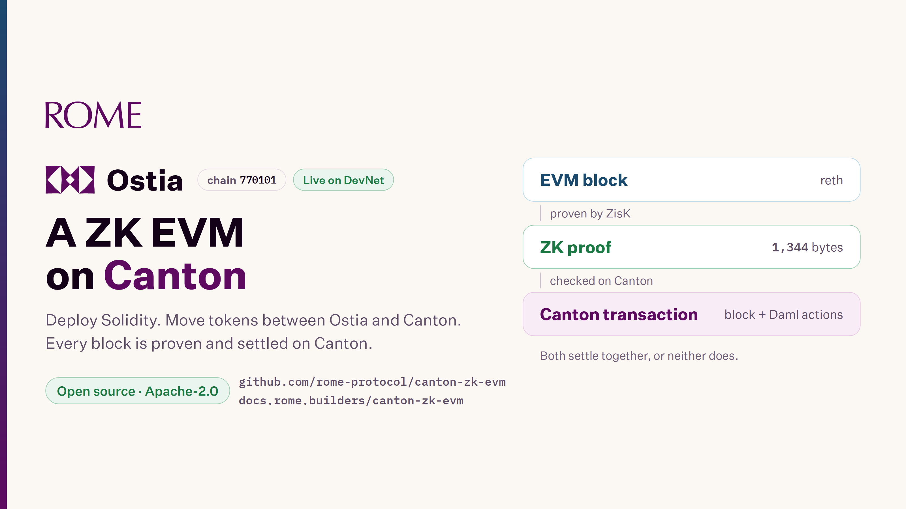

# Ostia: a ZK EVM on Canton, live on DevNet

*Posted on the Canton forum, 2026-11-09: https://forum.canton.network/t/ostia-a-zk-evm-on-canton-live-on-devnet/9472*

Hi all,

This is Rome Protocol's first post here. Ostia is an EVM chain that settles on Canton. ZisK, a zero-knowledge virtual machine, proves each block. One Canton transaction carries the block, its proof and the Canton actions the block asked for. The confirming participant's external call checks the proof. The block and the Canton actions settle together, or nothing commits.

Ostia is live on Canton DevNet. It is open to everyone, and the code is open source under Apache-2.0.

What you can do now:

- Deploy Solidity contracts with Foundry or Hardhat, as on Ethereum. The chain id is 770101 and the test coin is tROME.
- Move tokens between Ostia and Canton on the Bridge page. Canton Coin arrives on Ostia as the CC ERC-20. ERC-20s such as WtROME stand on Canton as CIP-0056 twins. Both move back. A move takes about 1 to 2 minutes.
- Send Canton Coin and twins to other Canton addresses from the same page. Incoming transfers have an Accept button, and you can take back a send that was not accepted.
- Open a Canton account by signing one message in your wallet if you have no Canton wallet yet. No gas, no Canton software. Only your key can move what the account holds, and Rome's validator hosts it but cannot sign for it.
- Take test coins: 1 tROME a day for everyone, 20 test Canton Coin a day on the Bridge, and 100 tROME for builders who sign in with GitHub on the faucet page: https://ostia.devnet.romeprotocol.xyz/faucet
- Compose with Canton assets: any contract can hold and move Canton Coin as the CC ERC-20. On your own Ostia, a payment through the gateway executes a Canton allocation, and the otc-venue Daml package depends only on CIP-0056.
- Watch it settle on the External calls page of the explorer: one Canton transaction per block. Since 22 October, more than 53,600 blocks with a 99.99% success rate. Over the last 24 hours, settlement took about 9 seconds on average and about 11 seconds at p95.

Docs, with the network values, the Bridge steps and the use cases: https://docs.rome.builders/canton-zk-evm/

Code: https://github.com/rome-protocol/canton-zk-evm

This is DevNet: tROME has no value, and Rome runs the Ostia services today. The Trust model and limits page in the docs says who checks what.

A question and an ask:

1. We derive a Canton key from an EVM wallet signature, so onboarding takes one signature. Is there a pattern you prefer for people who arrive with only an EVM wallet?
2. If you run a DevNet validator and would confirm Ostia blocks beside ours once we have a tested procedure, tell us.

For technical questions, bugs and ideas, open an issue in the GitHub repository. Report security problems through GitHub's private reporting. For anything else, reply here; we will read every reply.

The Rome Protocol team
