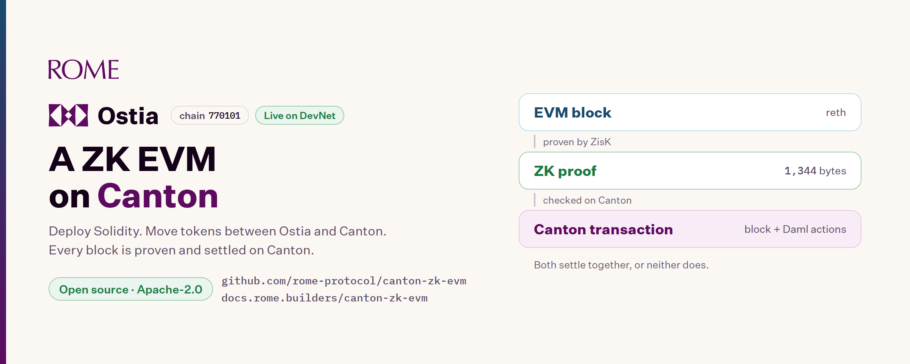

# Ostia: a ZK EVM on Canton, live on DevNet

*Published 2026-11-09 on X: https://x.com/RomeProtocol/status/2119877820411199959 (thread: https://x.com/RomeProtocol/status/2119879190577357272).*

Ostia is an EVM chain that settles on Canton. Every block is proven with zero-knowledge, and one Canton transaction carries the block, its proof and the Canton actions the block asked for. It is live on Canton DevNet today. It is open source under Apache-2.0, and anyone can use it.

You can deploy Solidity contracts with the tools you already use. You can move Canton Coin and tokens between Ostia and Canton, and back. You can send them to other Canton addresses. And you can watch each block settle on Canton.

- Docs: https://docs.rome.builders/canton-zk-evm/
- Code: https://github.com/rome-protocol/canton-zk-evm
- Bridge: https://ostia.devnet.romeprotocol.xyz/bridge

## What Ostia is

Ostia is an EVM chain with chain id 770101. Its test coin is tROME. Canton orders its blocks. ZisK, a zero-knowledge virtual machine, proves each block. The confirming participant checks the proof while it confirms the Canton transaction. The block and the Canton actions settle together, or nothing commits.

One contract, the gateway, records what a block needs from Canton: a deposit of a Canton token, a withdrawal to a Canton party, or a payment tied to a Canton allocation. Two more actions lock an ERC-20 into a vault and release it, so the token can stand on Canton as a twin. The proof covers all of them.

The whole picture: https://docs.rome.builders/canton-zk-evm/how-it-works

## What it enables

- Solidity apps on a chain that commits on Canton.
- Canton Coin inside EVM contracts, as an ERC-20.
- ERC-20s that stand on Canton as CIP-0056 twins.
- ERC-20 payments that execute a Canton allocation in the same Canton transaction.
- Swaps of a Canton token for an ERC-20 through a Daml venue.

## Where it runs

Ostia has run on Canton DevNet since 22 October 2026.

- Chain id: 770101
- RPC: https://ostia.devnet.romeprotocol.xyz/rpc
- Explorer: https://ostia.devnet.romeprotocol.xyz
- Faucet: https://ostia.devnet.romeprotocol.xyz/faucet
- Bridge: https://ostia.devnet.romeprotocol.xyz/bridge

## The Bridge

The Bridge is the page where Ostia and Canton meet. You open it with a browser wallet such as MetaMask. You need no Canton software.

Move tokens between Ostia and Canton. There are four moves:

- An Ostia token, such as tROME, to Canton. Your Canton account holds the same amount as a twin.
- The twin back to Ostia.
- Canton Coin to Ostia, where it arrives as the CC token, an ERC-20.
- CC back to Canton Coin.

Each move shows Sent, Proven and Final, with links to its Ostia block and its Canton update. A move takes about 1 to 2 minutes. The chain itself is final in about 10 seconds, and the rest is the wallet and the page waiting for the proven block. A Canton Coin deposit that cannot settle in time can be taken back.

Send on Canton. From the same page you can send Canton Coin or a twin to another Canton address. The page signs the send itself, so there is no wallet pop-up. Incoming transfers are listed with an Accept button, and you can take back a send that was not accepted. On DevNet, each of these took about 10 seconds or less.

No Canton wallet yet? Sign one message in MetaMask and you have a Canton account. Signing costs no gas. The first time, the page asks you to sign the same message once more, to check that your wallet gives the same signature each time. The signature opens an account that only your own key controls. It is named rome:: followed by your key's fingerprint. Rome's validator hosts it but cannot sign for it. The wallet and the account stay open after a reload, and you can open the same account again from any browser with the same wallet. "Close my Canton account on this browser" removes it.

One safety note. Your Canton key comes from that signature. Anyone who gets you to sign the same message gets your key. So sign it only at ostia.devnet.romeprotocol.xyz, and check that your wallet's pop-up names that site.

## Test coins and the builder grant

- The faucet gives every address 1 tROME a day.
- The Bridge gives your Canton account 20 test Canton Coin a day.
- Builders get 100 tROME by signing in with GitHub on the Faucet page: https://ostia.devnet.romeprotocol.xyz/faucet The GitHub account must be at least 30 days old. Each GitHub account and each address can take one grant every 7 days. Rome reads only the account's id and age from GitHub, and asks for no permissions.

Full steps: https://docs.rome.builders/canton-zk-evm/bridge

## Deploy Solidity

Ostia runs EVM contracts under Ethereum's rules up to Osaka. Foundry and Hardhat deploy as they do on Ethereum. forge verify-contract works against the explorer's Etherscan-compatible API, and the docs give ethers and viem setups. A receipt appears once its block is final on Canton, usually in 10 to 30 seconds. The RPC has no WebSocket, so poll eth_getLogs.

These have all run on Ostia: ERC-20, ERC-721 and ERC-1155 tokens, an ERC-3643 permissioned token, a Uniswap-style AMM and contracts that check zero-knowledge proofs on chain. On any block page, the Verify button checks the block's proof in your browser.

Deploy guide: https://docs.rome.builders/canton-zk-evm/build-on-ostia

## Compose with Canton

ERC-20s as Canton twins. An ERC-20 on Ostia can stand on Canton as a twin. The twin is a CIP-0056 token whose instrument id is erc20:<token address>. You pay the ERC-20 into the vault, and the Canton party you name holds the same amount as a twin. Redeeming pays it back. The explorer's twins page shows each twin's supply beside what the vault holds. TKA and WtROME have twins today.

Canton Coin on Ostia. CC is an ordinary ERC-20 with 10 decimals, at 0x4db3dea7c13116961fd3e438542ccfcca61a7547. Any contract can hold and transfer it. The gateway's Canton custody backs it one to one.

Payments and swaps with Canton parties. A payment through the gateway executes a Canton allocation. On 27 October, a Canton token was swapped for an ERC-20 this way: the payment and the seller's allocation settled in one Canton update (block 16816).

Daml apps that see Ostia's legs. On your own Ostia, you can run the OTC app, a separate Daml package that depends only on the Canton token standard. In the chain package, VenueTrade ties a trade's allocation to an EVM payment. Anyone can read every leg of the DevNet chain at https://ostia.devnet.romeprotocol.xyz/api/legs

Guides: https://docs.rome.builders/canton-zk-evm/build-with-canton and https://docs.rome.builders/canton-zk-evm/deposits-withdrawals-payments

## The External calls view

The explorer has an External calls page: https://ostia.devnet.romeprotocol.xyz/canton

It shows one Canton transaction for each block, where the confirming participant's external call checks the block's proof. Its header shows blocks committed, success rate, average and p95 settlement time, and retried and refused commits.

Today it shows more than 53,600 blocks since 22 October and a 99.99% success rate. Over the last 24 hours, settlement took about 9 seconds on average and about 11 seconds at p95. The gateway has settled more than 6,200 legs: deposits, withdrawals and payments.

## Use cases

- Solidity apps that commit on Canton, deployed with Foundry or Hardhat.
- Contracts that hold and move Canton Coin.
- Canton accounts that people open from an EVM wallet, and use to send and receive Canton Coin and twins.
- ERC-20s that stand on Canton as twins.
- ERC-20 payments that execute a Canton allocation.
- Swaps of a Canton token for an ERC-20.
- Canton apps tested against an Ostia of your own.
- Tools that use the open APIs to read and check what settled.

Details: https://docs.rome.builders/canton-zk-evm/use-cases

## Open source

The code is in one public repository: https://github.com/rome-protocol/canton-zk-evm

It holds the block builder, the prover scripts, the explorer, the Daml packages, the gateway and the scripts to run it all. Ostia is Apache-2.0. Anyone can use it, change it and build on it, including for commercial work. The licence gives no rights to the Rome, Rome Protocol and Ostia names. Contributions are welcome under the Developer Certificate of Origin. Technical questions, bugs and ideas go in GitHub issues: https://github.com/rome-protocol/canton-zk-evm/issues

You can run and check it yourself:

- run your own Ostia from the repository;
- check a block's proof in your browser;
- reproduce the proven program's key from source;
- check with cast keccak that the vault's code is the reviewed build;
- call the explorer's APIs, which need no keys.

Run your own: https://docs.rome.builders/canton-zk-evm/run-it-locally

## About trust

This is DevNet: tROME has no value, and Rome runs the Ostia services today. What the proof covers, and what it does not: https://docs.rome.builders/canton-zk-evm/trust-model

## Try it

1. Open https://ostia.devnet.romeprotocol.xyz/bridge, connect your wallet and sign one message.
2. Take the test tROME and Canton Coin, make one of the four moves, and send some to another Canton address.
3. Building something? Open https://ostia.devnet.romeprotocol.xyz/faucet, paste your address and sign in with GitHub for 100 tROME.
4. Add Ostia DevNet to your wallet and deploy a contract.
5. Tell us what you are building, and where it breaks, in a GitHub issue: https://github.com/rome-protocol/canton-zk-evm/issues
